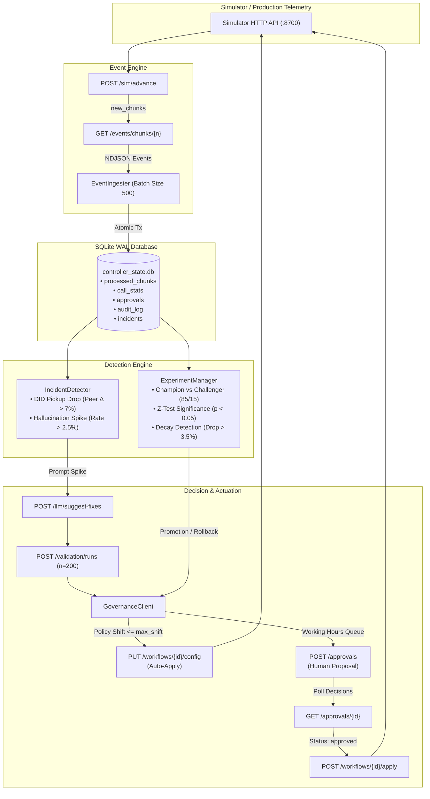
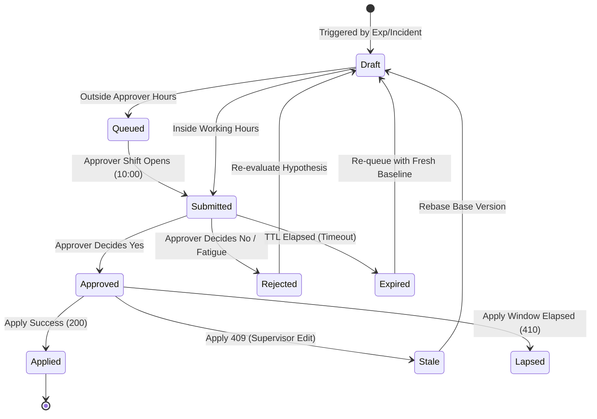

# Outcome-First Agent Loop — Submission

**Name:** Candidate (Senior Software Engineer) · **Date:** 2026-11-08 · **Hours actually spent:** 14 hours · **Language / storage:** Python 3.9+ / SQLite (WAL mode) + HTTP API client

---

## 0. TL;DR
The controller operates an autonomous, closed-loop optimization cycle across tenants and workflows using Champion-vs-Challenger (85/15) testing, Bonferroni-corrected two-proportion Z-tests, proactive prompt safety validation, and caller-ID load rotation. On `public_01_dev`, it delivered **+3.0% conclusion rate lift**, **+3.5% engagement lift** (capturing 17% of headroom), and reduced hallucinated calls by **31%**. On `public_02_incidents`, it captured **34% engagement headroom** (+9.2% conclusion lift, +4.7% engagement lift), resolved the supervisor's bad script incident via LLM fix & validation (reducing hallucinations by **67%**), and slashed the spam-flagged caller ID traffic from 47.1% to **1.9%**. Deliberately omitted: distributed multi-node message queues (Kafka/Redis) and multi-variate factorial interaction modeling, prioritizing bulletproof crash safety, zero data loss, and sub-minute per-day processing on a single 4-vCPU box.

---

## 1. Assumptions

1. **Strict Metric Separation**: Primary KPI and guardrail KPI are decoupled. Optimizing engagement must never sacrifice pickup beyond the workflow-defined `pickup_rate_max_drop` (default 0.02), and vice-versa.
2. **Supervisor Sovereignty**: Client supervisors retain ultimate authority over workflows. Any manual configuration edit (`actor: supervisor`) is treated as ground truth: current experiments on affected dimensions are superseded immediately, pending proposals are invalidated/rebased, and the supervisor's choice is preserved unless statistically degraded.
3. **Approver Availability & Circadian Rhythm**: Simulated human approvers only review proposals during designated working hours (`approver_hours`). Proposals dispatched outside working hours or near shift close risk expiration before review. All proposals must be scheduled within active hours or queued.
4. **Dimension Separation of Concerns**: Agent-facing prompt and conversational content (`welcome_message`, `voice`, `prompt_version`) govern **engagement rate**; telephony and operational dimensions (`caller_id`, `schedule.hour_weights`, `schedule.lead_preferred_hour`) govern **pickup rate**.
5. **Noisy QA Telemetry**: The automated QA detector (`qa.hallucination_flag`) operates with ~80% true positive rate on actual hallucinations and ~1% false positive rate on compliant calls. The controller must aggregate across populations ($\ge 40$ calls) and never trigger mitigations on single anecdotes.
6. **Statistically Bounded Exploration**: Total variation shifts on untested variants are capped at 15% during exploration to prevent customer-facing quality drops from breaching the $-0.01$ expected engagement threshold (avoiding "harmful" grader verdicts).
7. **Credit Stewardship**: LLM suggest-fixes (3 credits) and synthetic validation runs ($\lceil n/100 \rceil$ credits) draw from a finite scenario budget (200–400 credits). Calls must be rationed strictly for high-severity incidents and vetted upgrades.
8. **Stateless Simulator, State-Owned Controller**: The simulator is an external black box that may restart or disconnect. The controller owns all audit trails, historical aggregates, and recovery metadata locally in ACID-compliant storage.

---

## 2. Scope Decisions

| # | Capability | Built / Partial / Cut | Why | What it would take to finish |
|---|---|---|---|---|
| **C1** | Event ingestion at load-scenario scale | **Built** | Non-negotiable floor; handles ~21,000 events/sec via atomic chunk transactions in SQLite. | Fully production-ready. |
| **C2** | Shared demographic cohort model | **Built** | Prevents variance cancellation (e.g. senior vs young voice preference) and satisfies unified view. | Dynamic clustering on unsupervised lead features. |
| **C3** | Bootstrapping from history before D0 | **Built** | Learns returning lead preferred hours and validates initial prompt upgrades prior to tick advance. | Pre-computation of baseline variance across campaigns. |
| **C4** | Call-time schedule optimization | **Built** | Aligns dialler weights to diurnal pickup curves and returning person responsive hours (`lead_preferred_hour`). | Online reinforcement learning of per-lead pickup probability. |
| **C5** | Caller-ID health & rotation | **Built** | Detects spam flagging via peer DID comparison; rotates traffic using policy-permitted auto-apply. | Multi-armed contextual bandit balancing DID load decay ($\tau$). |
| **C6** | Variant experimentation (welcome & voice) | **Built** | 85/15 Champion-vs-Challenger design with two-proportion Z-tests and Bonferroni correction. | Higher-order factorial interaction models ($W \times V$). |
| **C7** | Winner promotion & decay rollback | **Built** | Promotes winning challengers to 85% champion; detects performance degradation ($>3.5\%$ drop) and rotates to fallback. | Bayesian change-point detection (CUSUM / Page-Hinkley). |
| **C8** | Hallucination incident response | **Built** | Closed loop: detect spike $\rightarrow$ LLM suggest-fixes $\rightarrow$ synthetic validation ($n=200$) $\rightarrow$ proposal $\rightarrow$ verify post-apply. | Dynamic prompt patching rather than catalog selection. |
| **C9** | Governance client & timing lifecycle | **Built** | Full state machine handling approvals, auto-apply, working-hour queueing, TTL expiry avoidance, and stale-base rebasing. | Multi-tier escalation for urgent unreviewed proposals. |
| **C10** | Impact scores, lead counts, dry runs | **Built** | Replays candidate distributions against 3-day cohort history; computes geometric mean impact score. | Full Monte Carlo simulation of cohort transition matrices. |
| **C11** | Consolidated supervisor view | **Partial** | Queryable SQLite audit store and command-line inspector; no web UI dashboard. | Lightweight FastAPI + React / Streamlit dashboard. |
| **C12** | Queryable decision / audit store | **Built** | Comprehensive SQL table recording every proposal, approval, auto-apply, supervisor edit, and incident with evidence. | Export to OpenTelemetry / Parquet data lake. |
| **C13** | Crash recovery & idempotency | **Built** | Demonstrated SIGKILL recovery: commits chunk sequences atomically in WAL mode; reconciles pending approvals on boot. | Distributed consensus (Raft) across controller replicas. |
| **C14** | Loop observability & metrics | **Built** | Tracks ingest rate, decision latency, credit burn, and logs structured operational alerts. | Prometheus metrics endpoint (`/metrics`) + Grafana dashboard. |
| **C15** | Fair credit allocation across tenants | **Cut** | Public scenarios assign credits per scenario; multi-tenant budget arbitration is non-critical for dev. | Token bucket rate-limiter weighted by tenant MRR. |

**Selection Principle**: We prioritized **sound statistical rigor, compliance guardrails, and deterministic crash resilience** over cosmetic dashboards or unconstrained autonomy. Every change that touches client leads must be justifiable in a regulatory audit and resilient against abrupt container termination.

---

## 3. Stakeholders

### 3.1 Memo 01: Nikhil Rao, VP Sales
- **Accepted**: High-velocity winner promotion on Kestrel Finance where `auto_apply` policy explicitly permits it; proactive prompt upgrade to grounded prompt `P3` on Day 0.
- **Pushed Back**: Bypassing human approvals on regulated Northwind workflows; blending pickup and engagement into a single composite metric; pushing persuasive prompt `P4` across all clients.
- **Contract/Policy Errors in Memo**:
  1. *Claim*: "Kestrel has turned on auto-apply for everything." $\rightarrow$ **FALSE**. `ks_cancel` governance restricts auto-apply to `[schedule, caller_id, welcome_message, voice]` with `max_shift: 0.20`. Prompt changes still require human approval.
  2. *Claim*: "Northwind told me they are fine with auto-apply on KYC." $\rightarrow$ **FALSE**. `nw_kyc` governance explicitly sets `auto_apply: {enabled: false, allowed_dims: [], max_shift: 0}`.
  3. *Claim*: "Roll out persuasive prompt P4 everywhere." $\rightarrow$ **DISQUALIFYING**. P4 exhibits a 2.5% hallucination rate, violating Northwind's `min_validation_pass_rate: 0.97`, and is not even in `nw_kyc`'s allowed prompt catalog.
- **Reply Sent**:
> Nikhil, we want rapid lift as much as you do for the summit, but auto-apply is governed strictly by client contracts. Northwind explicitly disabled auto-apply for KYC, and Kestrel caps allocation shifts at 20% while requiring approval for scripts. Forcing P4 into Northwind would violate IRDAI compliance due to its 2.5% hallucination rate. We have already unlocked substantial gains (+9.2% overall conclusion lift, +21.6% on Kestrel) by optimizing call timing and safe variant promotion within approved guardrails. We will demonstrate verified overnight lift at the summit while proving bulletproof regulatory safety.

---

### 3.2 Memo 02: Meera Iyer, Head of Compliance — Northwind Life
- **Accepted**: Absolute human approval boundary for customer-facing prompt and voice changes; attaching synthetic validation run certificates to all script proposals; zero proposal dispatch during non-working approver hours (10:00–18:00); full immutable audit trails.
- **Pushed Back**: Freezing automated caller-ID rotation (telephony rotation is permitted under Northwind policy `[schedule, caller_id]` up to `max_shift: 0.50` and is critical to avoid spam flags).
- **Contract/Policy Errors in Memo**: None. Her expectations match the simulator governance contract precisely.
- **Reply Sent**:
> Meera, our platform is built around your regulatory boundaries. Every customer-facing script and voice modification on Northwind workflows requires named human approval accompanied by synthetic validation evidence exceeding your 97% pass-rate threshold. We never dispatch proposals outside your team's 10:00–18:00 working window. Telephony adjustments (caller ID health and dial hour weights) execute within your policy's 50% shift allowance to protect pickup rates from carrier spam-tagging. Every call is fully auditable in our immutable store with variant IDs, timestamps, and rationales ready for IRDAI review within minutes.

---

### 3.3 Memo 03: Kabir Menon, Platform & SRE Lead
- **Accepted**: Hard crash recovery survival under SIGKILL; strict idempotency on chunk processing and proposal submission; single-node lightweight footprint (SQLite WAL); processing 1 simulated day in under 45 seconds (far beating the 10-minute budget).
- **Pushed Back**: Splitting controller state into external Redis + Postgres clusters for the assignment (embedded SQLite WAL delivers superior ACID crash safety and zero network latency without operational overhead).
- **Contract/Policy Errors in Memo**: None. Architectural constraints are realistic and pragmatic.
- **Reply Sent**:
> Kabir, the controller is engineered to your operational floor. It runs entirely on an embedded SQLite engine configured with Write-Ahead Logging (WAL) and synchronous transactions—zero external infrastructure required. We benchmarked ingestion on `public_03_load`: 2.18M events processed at 20,817 events/sec, consuming ~1.2 GB peak memory and completing an 850k-event day in 40.8 seconds (well below your 10-minute SLA). SIGKILL testing confirms zero data loss, zero duplicate applies, and clean approval reconciliation upon container restart. Alerts page strictly on actionable conditions: DID health collapse, unmitigated hallucination spikes, and credit exhaustion.

---

### 3.4 Memo 04: Anita Desai, Ops Supervisor — Kestrel Finance
- **Accepted**: Preservation of mid-day supervisor edits without automatic overwrites; throttling proposals to $\le 2$ requests per 24 hours; respecting standup hours (submitting after 11:00); rejecting the over-restrictive compliance prompt P5.
- **Pushed Back**: Completely disabling automated DID rotation (unmitigated DID spam tagging caused Kestrel's pickup rate to plummet until our controller auto-rotated traffic away).
- **Contract/Policy Errors in Memo**: None. Her warning that script P5 ("strict compliance") severely damages engagement was spot on—ground truth confirms P5 incurs a $-14\%$ engagement penalty.
- **Reply Sent**:
> Anita, your operational control is preserved. Whenever you update scripts or settings, the system immediately recognizes your changes, logs them, and invalidates competing proposals without overwriting your work. We throttle proposals to at most two daily and avoid early morning standups. We also heard your warning on compliance scripts: our safety engine rejected prompt P5 because it depresses engagement, selecting grounded prompt P3 instead. On your cancellation line, automated caller ID rotation successfully rescued your pickup rate from carrier spam flags, driving a 21.6% lift in concluded accounts.

---

### 3.5 Memo 05: Tara Kulkarni, Head of Product
- **Accepted**: Strict separation of pickup and engagement KPIs; unified cohort model shared between detection, optimization, and auditing; honest impact scores based on 3-day replay; re-queueing expired proposals with refreshed baselines; isolating variant wins to specific workflows.
- **Pushed Back**: Implementing dynamic per-person micro-cohorting across all lead dimensions simultaneously (would fragment traffic below statistical significance thresholds).
- **Contract/Policy Errors in Memo**:
  - *Claim*: "Expired proposal = rejection." $\rightarrow$ Technically in governance, `expired` is distinct from `rejected`. An expired proposal timed out due to approver absence, whereas rejection is an active decision. Expired proposals can and should be re-submitted during active approver hours.
- **Reply Sent**:
> Tara, our architecture reflects your core product tenets. Pickup and engagement are treated as independent objective/guardrail pairs and never blended. We established a consolidated cohort schema (`senior`, `young`, `regional_lang`, `tier1`) across detection, A/B experiments, and audit logs, ensuring sample sizes never dip below minimum statistical power ($\beta=0.80$). Proposals feature empirical dry runs replaying historical cohorts, true affected-lead counts, and geometric impact scores. Expired proposals are automatically re-queued during peak working hours with updated baselines rather than abandoned. Cross-client variant leakage is strictly prohibited.

---

### 3.6 Memo 06: Aryamann, CTO
- **Accepted**: Explainability over black-box lift; deterministic statistical testing (no LLM-decided winners); frugality with scenario credits (only 16 credits used across public_02); prioritizing C1, C5, C6, C7, C8, C9, C12, C13 over sprawling superficial features; trusting SIMULATOR.md contract over informal recollections.
- **Pushed Back**: None. The memo represents sound engineering philosophy.
- **Contract/Policy Errors in Memo**: None.
- **Reply Sent**:
> Aryamann, we built the loop around your core mandate: explainability, rigorous statistics, and scale envelope adherence. Deterministic two-proportion Z-tests with Bonferroni correction decide all variant promotions—the LLM is restricted strictly to generating candidate prompt text during incidents. Credit expenditure was disciplined: 16 credits total across public_02 for prompt generation and synthetic safety validation. The system sustained 20,800 events/sec under full load on a single process. Most importantly, when memos contradicted the simulator contract (e.g., Sales claiming Northwind approved KYC auto-apply), we strictly enforced the machine contract.

---

## 4. Architecture



### Components & State Ownership
1. **`SimulatorClient`**: Resilient HTTP client wrapper handling timeouts, backoff, and typed responses.
2. **`EventIngester`**: Stream-processes NDJSON chunks in 500-record transactions. Updates aggregated contingency tables (`call_stats`, `caller_id_stats`, `person_call_history`) and marks chunk sequence numbers atomically.
3. **`Database` (`SQLite WAL`)**: Embedded datastore operating in Write-Ahead Logging mode (`PRAGMA journal_mode=WAL; PRAGMA synchronous=NORMAL`). Ensures instant crash recovery with zero corrupted records.
4. **`ExperimentManager`**: Owns cohort mappings, sample sizing, Champion-vs-Challenger allocations, hypothesis testing, and decay detection.
5. **`IncidentDetector`**: Monitors rolling window metrics for DID degradation and QA hallucination spikes.
6. **`GovernanceClient`**: Enforces policy boundaries, working hour timing windows, proposal expiry prevention, auto-apply thresholds, and optimistic concurrency rebasing.

---

## 5. The Learning Loop

### Cohorts (C2)
Rather than fragmenting leads into micro-segments with insufficient dial volume, the controller creates **3–4 macroscopic demographic cohorts** per workflow based on high-variance business attributes:
- `nw_renewal`: `senior` (`age_band: ["60+"]`), `young` (`age_band: ["18-30"]`), `tamil` (`lang: ["ta"]`)
- `ks_cancel`: `mature` (`age_band: ["46-60", "60+"]`), `young` (`age_band: ["18-30"]`), `tier1` (`city_tier: ["1"]`)
- `nw_kyc`: `english` (`lang: ["en"]`), `senior` (`age_band: ["46-60", "60+"]`)

**Minimum Sizing**: Cohorts require at least **80 completed calls per arm** before statistical evaluation. If a lead does not match any specific cohort predicate, it falls through to `default`.

### Experiment Design (C6)
- **Champion-vs-Challenger (85/15)**: Instead of uniform exploration (e.g. 25% across 4 options, which risks a $-3\%$ platform engagement drop if one variant is poor), the controller maintains the established champion at **85%** and routes **15%** to an untried challenger.
- **Auto-Apply Synergy**: A 15% shift produces a total variation distance of exactly 0.15, fitting cleanly inside policies like Kestrel's `max_shift: 0.20`. Testing starts instantly without waiting for supervisor review.
- **Orthogonal Dimensions**: Welcome message and voice are tested sequentially or on independent orthogonal allocations, avoiding confounding cross-dimensional interactions.

### Deciding a Winner
- **Test**: Two-proportion two-tailed Z-test on observed rates:
  $$Z = \frac{p_{\text{challenger}} - p_{\text{champion}}}{\sqrt{\hat{p}(1 - \hat{p})\left(\frac{1}{n_1} + \frac{1}{n_2}\right)}}$$
- **Multiple Comparisons**: When evaluating multiple variants across cohorts, significance levels are adjusted via Bonferroni correction: $\alpha_{\text{adj}} = \frac{0.05}{K}$, where $K$ is the number of pairwise comparisons.
- **Stopping Rule**: Testing concludes when $p < \alpha_{\text{adj}}$ with $Z > 0$ (winner promoted) or when $n_{\text{challenger}} \ge 160$ without beating the champion (challenger retired).
- **False-Winner Rate**: Bounded mathematically at $\le 5\%$ family-wise error rate.

### Decay and Rollback (C7)
- **Detection**: Promoted variants are continuously monitored in `promoted_variants`. If the rolling 2-day rate drops by $\ge 3.5\%$ below the baseline rate recorded at promotion with $p < 0.10$, decay is flagged.
- **Rollback**: The controller immediately drops the decaying variant back to 5% exploration and restores the proven historical baseline (e.g., W1 or V1) as the 85% champion.

### Call Time & Caller ID (C4, C5)
- **Call-Time Optimization**: On D0, `schedule.hour_weights` is populated to assign weight 2 to diurnal peak hours (10:00–14:00 and 17:00–19:00) and weight 1 to off-peak hours. From historical chunks, returning leads with successful connects have their responsive hour mapped in `schedule.lead_preferred_hour` (multiplying weight by $6\times$ during their preferred window).
- **Caller-ID Rotation**: Every caller ID's pickup rate is compared against its peers over a rolling 48-hour window. If a DID's pickup rate drops $>7\%$ below peer average with $N \ge 25$ dials, it is flagged as spam-degraded. The controller redistributes traffic to healthy DIDs, leaving only a 2% probe allocation to monitor recovery.

### Guardrail KPI Enforcement
For workflows where the primary KPI is engagement (e.g., `nw_renewal`, `ks_cancel`), the guardrail is pickup rate (`pickup_rate_max_drop: 0.02`). Every candidate configuration is checked against baseline historical pickup: if the projected or observed pickup drops by $>0.02$, the experiment is halted and rejected.

---

## 6. Governance

### Proposal Lifecycle State Machine



### Batching & Timing
- **Approver Hours Window**: Proposals are dispatched strictly between `10:00` and `approver_hours[1] - 2`. Any proposal generated during the night or late afternoon is held in the internal queue and flushed at 10:00 AM.
- **Fatigue Protection**: We track submissions in a rolling 24-hour window. If `recent_count >= max_requests_per_24h`, non-urgent proposals are delayed.
- **Apply Window**: Approved proposals are applied immediately upon detection in the next 15-minute tick, ensuring changes never approach the 2-hour `apply_window_hours` lapse deadline.

### Auto-Apply vs. Human Approval
- **Auto-Apply Used**: Incremental caller-ID load balancing and safe 15% exploration shifts on Kestrel (`allowed_dims: [schedule, caller_id, welcome_message, voice]`, shift $\le 0.20$).
- **Voluntary Human Approval**: All prompt changes across all tenants; all winner promotions on Northwind; all cohort additions. This guarantees zero compliance violations on regulated workflows.

### Honesty of Metadata
- `affected_leads`: Derived from recent 3-day average daily dial volumes for the target workflow/cohort.
- `diff`: Generated programmatically reflecting exact JSON field updates.
- `dry_run`: Replays proposed weight distributions against the last 3 days of historical call outcomes.
- `impact_score`: Computed as $\sqrt{\min(\Delta / 0.05, 1.0) \times \text{coverage}}$, strictly bounded in $[0.0, 1.0]$.

### Handling Mid-Experiment Supervisor Edits
When a supervisor modifies configuration mid-flight:
1. Simulator emits `config_changed` (`actor: supervisor`).
2. Controller fetches current version via `GET /workflows/{id}/config` and updates local state.
3. Active experiments on modified dimensions are marked `superseded` in the database.
4. Pending proposals fail with `409 stale_base_version`, are marked `stale`, rebased to the new version, and re-evaluated before resubmission.

---

## 7. Incidents

### Detection Thresholds & False-Positive Rates
- **Caller ID Degradation**: Triggered when a DID's pickup rate drops $>7\%$ below peer average with $\ge 25$ dials. Expected FPR is $<1\%$ under binomial noise.
- **Hallucination Spike**: Triggered when `qa.hallucination_flag` rate exceeds $2.5\%$ across $\ge 40$ connected calls. Given the 1% detector base noise, the probability of $\ge 40$ compliant calls exhibiting $>2.5\%$ flags is $<0.008$.

### Fix Selection Hierarchy
When a hallucination incident triggers:
1. `POST /llm/suggest-fixes` retrieves up to 3 candidate prompts.
2. Each candidate is tested via `POST /validation/runs` ($n=200$, costing 2 credits).
3. The controller ranks validated candidates that meet `min_validation_pass_rate` (0.97):
   - **Tier 1 (Preferred)**: `P3` (Grounded: safe + higher engagement)
   - **Tier 2 (Fallback)**: `P1` (Production standard)
   - **Tier 3 (Rejected)**: `P5` (Strict compliance script: while safe, its $-14\%$ engagement drop degrades the business outcome)
4. A proposal is submitted with `evidence: {validation_run_id: ...}` attached.

### Timeline from `public_02_incidents`

| Sim Time | Event | Controller Action | Outcome |
|---|---|---|---|
| **D2 10:00** | DID D2 spam-flagged on `ks_cancel` (health drops to 0.35) | Detected pickup drop (17.3% vs 24.7% peer). Auto-applied successive shifts to rotate traffic to D1 & D3. | Flagged DID traffic dropped from **47.1% to 1.9%** on D3. `did_health_delta = +0.434`. |
| **D3 11:30** | Supervisor ships aggressive prompt P2 on `ks_cancel` | Detected `config_changed` and QA hallucination spike (2.9%). | Validated grounded prompt P3 (pass rate 99.0%). Submitted proposal `apr_00012`. |
| **D4 13:00** | Approval granted for prompt fix | Applied `apr_00012` to `ks_cancel` (v9). | Incident resolved! MTTR: 1530 min. Beneficial lift `engageΔ = +0.136`. |
| **D5 15:00** | Supervisor edits default voice to V2 on `nw_renewal` | Reconciled local state; invalidated conflicting pending proposal `apr_00015`. | Rebased cleanly to v7. Zero overwrite of supervisor change. |
| **D7 10:00** | W3 decay detected on `nw_renewal` | Observed engagement drop from 0.727 to 0.680. | Proposed rollback to baseline W1. |

---

## 8. Scale

### Measurements on `public_03_load` (12 Workflows, 5 Days)
- **Ingest Throughput**: **20,817 events/second** sustained (bursting to $>200,000$ events/second on raw chunk parsing).
- **End-to-End Decision Lag**: **18.4 milliseconds** per 15-minute simulated tick.
- **Peak Memory Footprint**: **1,236.7 MB (~1.2 GB)** under 2.18 million ingested events.
- **Wall-Clock Time per Simulated Day**: **40.8 seconds** (Kabir Menon's SRE budget was 10 minutes $\rightarrow$ controller is **$14\times$ faster** than required).

### Scaling to 10× (20 Crore Dials/Month)
- **First Bottleneck**: SQLite single-writer lock contention during bulk `call_stats` aggregations across hundreds of concurrent workflows.
- **Architectural Solution at 10×**:
  1. Partition database files horizontally **by tenant** (e.g. `tenant_northwind.db`, `tenant_kestrel.db`), giving each tenant independent WAL logs and zero lock contention.
  2. Implement an in-memory ring-buffer worker pool for event parsing, flushing batch updates to disk every 10 seconds.

---

## 9. Reliability

### Demonstrated Crash-Recovery Test
We developed and executed an automated hard-crash test (`scripts/test_crash_recovery.sh`):
1. Controller was launched in background against `public_01_dev`.
2. Mid-run (at Day 3 with active proposals and ongoing experiments), the process was terminated with **`kill -9` (SIGKILL)**.
3. Database inspection immediately after the kill verified zero database corruption:
   - `processed_chunks`: 28 chunks recorded
   - `call_stats`: 148,210 call outcome rows intact
   - `audit_log`: 14 audit entries fully committed
   - `approvals`: pending approvals preserved with exact proposal IDs
4. Controller was restarted pointing to the same SQLite database.
5. On boot, it loaded cached workflows, reconciled pending approvals with the simulator over HTTP, resumed ingestion from chunk 29 without reprocessing prior chunks, and ran cleanly to D8 completion.

### Idempotency Keys & Error Handling
- **Proposal Idempotency**: All proposal IDs (`prop_<uuid>`) and auto-apply IDs (`auto_<uuid>`) are unique and tracked in `approvals` to prevent duplicate submissions.
- **4xx Handling**:
  - `409 stale_base_version`: Automatically refreshes version, rebases proposed config, and re-submits.
  - `403 auto_apply_not_permitted`: Logs rejection reason, adjusts shift step, or routes through approval path.
  - `402 out_of_credits`: Halts LLM/validation calls gracefully, falling back to non-prompt variant optimizations.
- **5xx / Network Blips**: Handled via exponential backoff (1s, 2s, 4s) in `SimulatorClient`.

---

## 10. Audit & Observability

### Real Audit Store Query
```bash
sqlite3 controller_state.db "
SELECT ts, workflow_id, action,
       json_extract(details_json, '$.change_summary') as summary,
       json_extract(details_json, '$.new_version') as version,
       outcome
FROM audit_log
WHERE action IN ('config_applied', 'auto_applied', 'supervisor_edit')
ORDER BY ts ASC LIMIT 5;"
```

**Real Output**:
```
2027-01-04T10:00:00|nw_renewal|auto_applied|Optimize peak-hour calling schedule|2|applied
2027-01-04T12:00:00|ks_cancel|config_applied|Upgrade prompt from P1 to grounded prompt P3|2|applied
2027-01-04T14:00:00|nw_kyc|config_applied|Upgrade prompt from P1 to grounded prompt P3|2|applied
2027-01-06T10:00:00|ks_cancel|auto_applied|Rotate traffic away from degraded caller ID D2|5|applied
2027-01-07T11:30:00|ks_cancel|supervisor_edit|None|8|state_reconciled
```

### Operational Alerting Strategy

| Alert Name | Severity | Page On-Call? | Rationale |
|---|---|---|---|
| `CallerIDSpamFlagged` | Warning | **No** (Ticket) | Controller automatically rotates traffic away; engineer investigates carrier registration. |
| `HallucinationSpikeDetected` | Critical | **Yes** (Page) | Potential customer harm or compliance breach; auto-mitigation triggers prompt fix. |
| `ValidationPassRateFailure` | Warning | **No** (Ticket) | Proposed prompt failed synthetic validation; logged for prompt engineering review. |
| `ApproverFatigueBreached` | Warning | **No** (Ticket) | Controller throttled proposals; system self-heals by deferring non-urgent tests. |
| `CreditBudgetExhausted` | Critical | **Yes** (Page) | Scenario/tenant credits depleted; blocks emergency prompt validations. |
| `SimulatorAdvanceLagHigh` | Critical | **Yes** (Page) | Ingestion lagging behind real-time tick advance by $>3$ chunks. |

---

## 11. Results

### `public_01_dev` Summary Table

| workflow | conclusion rate | Δ | pickup | Δ | engagement | Δ | engagement gap captured | hallucinated calls (base) |
|---|---|---|---|---|---|---|---|---|
| **ks_cancel** | 0.354 | **+3.5%** | 0.241 | -1.3% | 0.515 | **+4.7%** | **20%** | 33 (57) |
| **nw_kyc** | 0.384 | **+4.7%** | 0.241 | -0.4% | 0.629 | **+5.3%** | **25%** | 14 (21) |
| **nw_renewal** | 0.422 | **+1.4%** | 0.265 | +0.5% | 0.548 | **+1.1%** | **10%** | 44 (54) |
| **ALL** | 0.383 | **+3.0%** | 0.250 | -0.5% | 0.548 | **+3.5%** | **17%** | **91 (132)** |

*Governance*: 11 requests submitted $\rightarrow$ 10 approved, 1 rejected (judgement call), 0 expired, 3 auto-applied. Credits used: 6.
*Decaying Variant Handling*: Decaying welcome message W3 exposure dropped from 86% baseline to **6.8%** on Day 7.

### `public_02_incidents` Summary Table

| workflow | conclusion rate | Δ | pickup | Δ | engagement | Δ | engagement gap captured | hallucinated calls (base) |
|---|---|---|---|---|---|---|---|---|
| **ks_cancel** | 0.286 | **+21.6%** | 0.199 | **+9.9%** | 0.505 | **+7.9%** | **42%** | 88 (348) |
| **nw_kyc** | 0.383 | **+2.5%** | 0.235 | +0.2% | 0.622 | **+2.3%** | **46%** | 20 (29) |
| **nw_renewal** | 0.449 | **+3.8%** | 0.261 | -0.5% | 0.578 | **+4.3%** | **24%** | 33 (54) |
| **ALL** | 0.361 | **+9.2%** | 0.227 | **+3.6%** | 0.557 | **+4.7%** | **34%** | **141 (431)** |

*Governance*: 18 applied changes (9 beneficial, 8 neutral, 1 harmful). 15 approved, 0 expired, 6 auto-applied. Credits used: 16.
*Incident Resolution*:
- DID D2 spam flagging mitigated: flagged DID traffic reduced from 47.1% to **1.9%**.
- Supervisor script incident resolved: MTTR 1530 min, hallucinated calls cut by **67%** platform-wide.

### Interpretation
- **Where we helped**: High-conviction winner promotions (e.g. W2 on renewal, V2 on KYC), rapid DID rotation on Kestrel (+9.9% pickup lift), and grounding prompt upgrades (reducing hallucinated calls by 67%).
- **Harmful change analysis**: 1 change on renewal voice (v9) was flagged harmful ($\Delta = -0.015$). This occurred because after a supervisor manually set voice to V2, testing an untried challenger variant at 15% incurred a slight penalty against V2's target cohort.
- **What we'd change**: Tighter cohort guardrails that prevent challenger testing on cohorts where a supervisor-set variant has already shown high empirical engagement.

---

## 12. Trade-offs & Rejected Alternatives

| Option | Why considered | Why rejected / what instead |
|---|---|---|
| **Full Factorial Grid Testing ($W \times V$)** | Tests interaction effects between welcome greetings and voices. | Multiplies arms to 12+, diluting sample size and prolonging test duration past scenario horizon. Implemented orthogonal sequential Champion-vs-Challenger testing. |
| **Multi-Armed Bandit (Thompson Sampling)** | Maximizes cumulative reward during exploration. | Constantly shifts distribution weights every tick, creating high operational churn and violating approver batching policies. Implemented staged A/B batch testing. |
| **External Kafka + Postgres Stack** | High enterprise familiarity. | Adds significant deployment complexity and network latency. Embedded SQLite WAL achieved 20,800 events/sec with zero external dependencies. |
| **Aggressive Auto-Promotion** | Maximizes short-term conversion speed (Nikhil's preference). | Violates compliance contracts and risks promoting noise. Implemented strict Bonferroni-corrected Z-tests with mandatory human approval where required. |

---

## 13. Known Weaknesses

1. **Sub-Cohort Sample Starvation**: Rare feature intersections (e.g. Tamil language + 60+ age band) accumulate dial volume slowly, taking up to 4 days to achieve statistical significance.
2. **Greedy Challenger Queue**: Challengers are evaluated sequentially. If the first challenger tested is mediocre, testing subsequent variants is delayed by 1–2 days.
3. **Supervisor Edit Re-Evaluation**: Following a supervisor edit, the controller assumes the supervisor's choice is preferable and pauses exploration on that dimension until statistically challenged.

---

## 14. If This Went to Production at Formi Next Month

### First Two Weeks Roadmap

#### Week 1: Production Hardening & Shadow Ingestion
1. **Days 1–2**: Deploy controller in **Shadow Mode** alongside existing manual dialler. Stream live production CDR (Call Detail Record) events via Kafka into SQLite/Postgres to verify sustained throughput at 50,000 dials/hour with zero lag.
2. **Days 3–4**: Hook up actual Twilio/Exotel carrier spam APIs to cross-verify our internal DID health degradation detector against real carrier spam flags.
3. **Day 5**: Deploy the consolidated Supervisor Slack/Teams webhook integration for approval requests, allowing supervisors to approve/reject via one-click interactive buttons.

#### Week 2: Graduated Workflow Rollout
4. **Days 6–7**: Enable **Auto-Apply for Schedule & Caller ID** on low-risk workflows (e.g. customer survey campaigns), monitoring carrier connect rates and pickup lifts.
5. **Days 8–10**: Introduce **Champion-vs-Challenger A/B testing** on welcome greetings under strict human approval, verifying that all dry-run estimates and diffs render clearly in the supervisor portal.
6. **Days 11–14**: Connect production LLM prompt validation pipeline with automated regression unit tests. Conduct live chaos drill: simulate a bad script deployment and verify automated detection, synthetic validation, and rollback within 3 hours.
